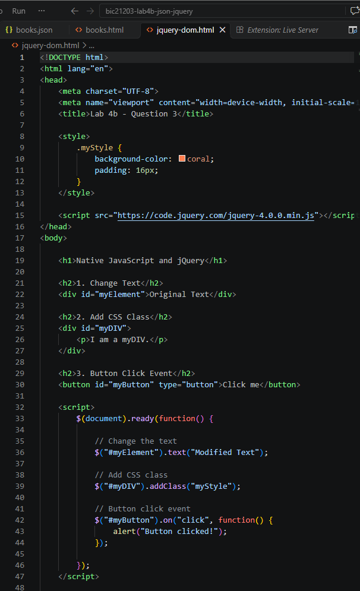
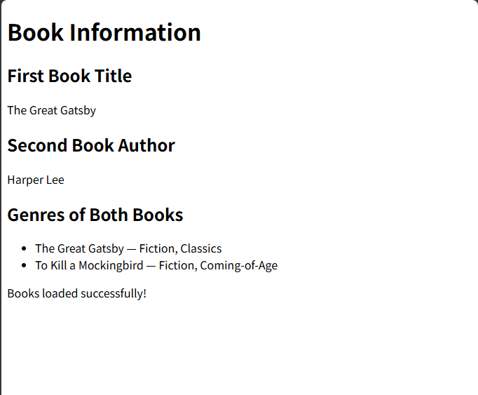
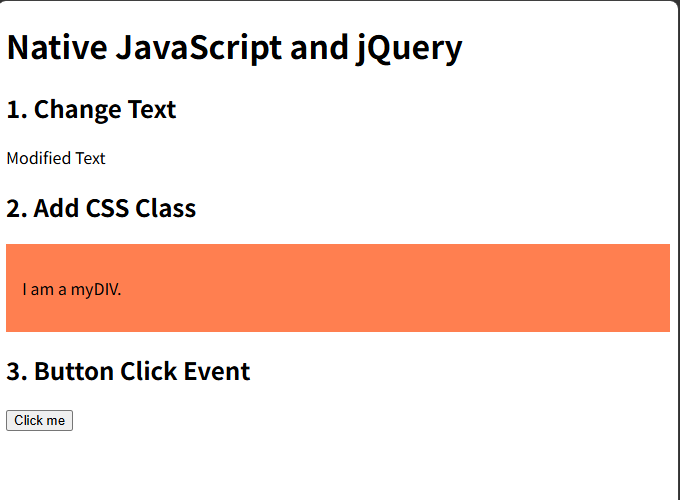
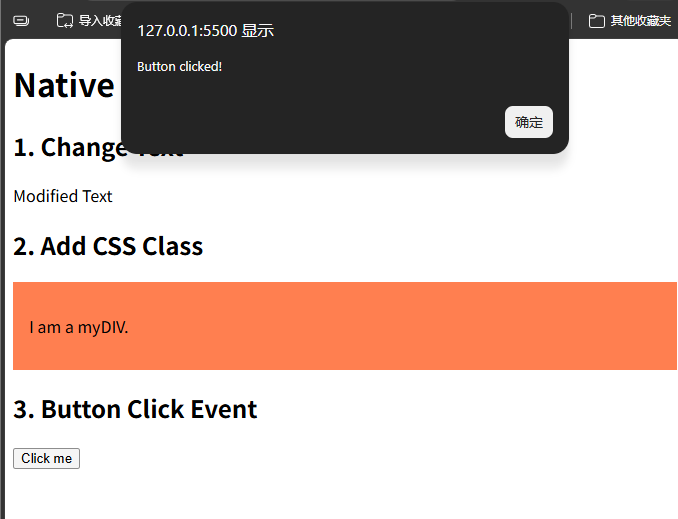

# Lab 4b - Client-Side Scripting (JSON and jQuery)

Course: BIC21203 Web Development

Name: Lau Boon Chai

Student ID: AI240147

## Introduction
This lab focuses on JSON data, JavaScript fetch(),
and jQuery DOM manipulation.

## Question 1 - Create and Structure JSON Data
I created a books.json file containing two books.
Each book includes a title, author, publication year,
and genres.

## Question 2 - Retrieve and Display JSON Data
I used JavaScript fetch() to read the books.json file.
The webpage displays the first book title, the second
book author, and the genres of both books.

The webpage also displays an error message if
the JSON file cannot be loaded.

## Question 3 - Native JavaScript and jQuery
I used jQuery to perform three operations:
1. Change Original Text to Modified Text.
2. Add a CSS class with a coral background.
3. Display an alert when a button is clicked.

## How to Run
1. Download or clone this repository.
2. Open the folder in Visual Studio Code.
3. Install the Live Server extension.
4. Right-click books.html and select Open with Live Server.
5. Check the book information on the webpage.
6. Open jquery-dom.html using Live Server.
7. Click the button to test the alert message.

Note: An internet connection is required to load
jQuery from the CDN.

## Screenshots

### Question 1 - JSON Data

### Question 2 - JSON Output

### Question 3 - jQuery Output

### Question 3 - Button Alert

## Conclusion
I learned how to create and read JSON data.
I also learned how to use fetch() to display
information on a webpage.
Finally, I learned how jQuery can change
HTML elements and handle button events.
